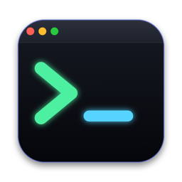

# ShellDock

A native macOS terminal and remote-tools app (SwiftUI + AppKit, [SwiftTerm](https://github.com/migueldeicaza/SwiftTerm)). SSH, SFTP, tunnels, MultiExec, VNC, serial and a built-in Linux VM, with **no session limits**. Original code, inspired by the classic "remote toolbox" workflow; not affiliated with any other product.

Website: https://loiro85.github.io/ShellDock/

## Download
Get the latest `.dmg` or `.pkg` from the [Releases](https://github.com/loiro85/ShellDock/releases) page (universal: Apple Silicon + Intel, macOS 13+).

The build is ad-hoc signed and not notarized yet, so on first launch use right-click → **Open**, or:

    xattr -dr com.apple.quarantine /Applications/ShellDock.app

## Features
- **Sessions:** local terminal, SSH (with SFTP side panel reusing the connection, jump hosts), SFTP/FTP/FTPS, Telnet, Rlogin, raw TCP, serial, Mosh (if installed), native VNC, RDP launcher, web browser tab and **Mini Linux** (Alpine VM, shared folder at `/mnt/mac`, persistent packages). MobaXterm `.mxtsessions` importer.
- **Interface:** ribbon with icon + label, session tree, tabs with "+", drag-and-drop file panel, built-in text editor, remote monitor bar (CPU, memory, disk, uptime).
- **MultiExec:** all terminals in a grid; typing goes to all of them, with an *Exclude* checkbox on each. **Split** shows terminals side by side.
- **Productivity:** right-click paste (configurable), macros, snippets with variables, SSH tunnels, keyword highlighting (Telnet/TCP/serial), optional master password.
- **Tools:** port and network scanner, ping/traceroute/DNS/whois, Wake-on-LAN, SSH key manager, password generator, hashes, Base64/URL/Hex, subnet calculator, Unix time, HTTP file server.
- **Languages:** English (default), Español, Français, Italiano, Deutsch, Português (Settings → Appearance → Language).

## Build
    scripts/build_app.sh --release     # dist/ShellDock.app
    scripts/make_installer.sh --universal   # dist/ShellDock-<version>.dmg and .pkg
    swift test                         # 74 tests

Set `SIGN_IDENTITY`, `INSTALLER_IDENTITY` and `NOTARY_PROFILE` to sign and notarize with a Developer ID.

## Adding a language
Add a column in `tools/translations/*.py`, then run `python3 tools/i18n_build.py`. Translations were written by the author and would benefit from native-speaker review.

## Known limitations
- Keyword highlighting does not apply to SSH or local terminals.
- No built-in X server (use XQuartz), no XDMCP; RDP opens in "Windows App" instead of embedding.
- Mini Linux needs the `com.apple.security.virtualization` entitlement (works with ad-hoc signing).
- Intel slice and real VNC/RDP/serial hardware are untested.

## Docs
[`docs/PLAN.md`](docs/PLAN.md) · [`docs/MOBAXTERM_PARITY.md`](docs/MOBAXTERM_PARITY.md) · [`docs/SECURITY.md`](docs/SECURITY.md)

## License
MIT — see [LICENSE](LICENSE).
